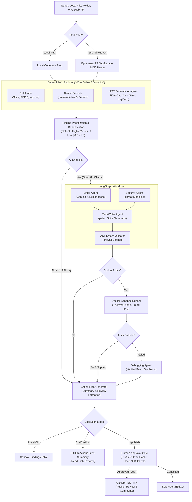
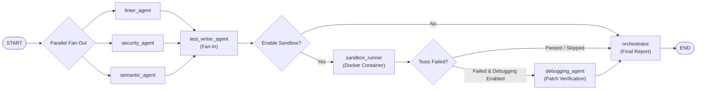

# Multi-Agent Code Review & Debugging Pipeline

[](https://github.com/mashkoorshaikh/multi-agent-code-review-pipeline/actions/workflows/ci.yml)
[](tests/)
[](pyproject.toml)
[](LICENSE)
[](SECURITY.md)

> **Autonomous, multi-agent code analysis, semantic bug detection, sandboxed test execution, and verified patch synthesis for Python.**

The **Multi-Agent Code Review & Debugging Pipeline** is a developer tool that bridges **deterministic static analysis** (Ruff, Bandit, and AST semantic inspection) with **specialized AI agents** orchestrated via **LangGraph**. It discovers lint violations, security vulnerabilities, and runtime exceptions (like division-by-zero and `None` dereferences), generates targeted test suites to reproduce them, runs those tests safely inside **isolated Docker containers**, and synthesizes verified minimal diff fixes—all guarded by a cryptographic human approval gate.

---

## ⚡ 60-Second Quick Start

You can run deterministic reviews immediately **without an OpenAI API key or Docker**:

```bash
# 1. Clone the repository
git clone https://github.com/mashkoorshaikh/multi-agent-code-review-pipeline.git
cd multi-agent-code-review-pipeline

# 2. Set up virtual environment
python -m venv .venv
source .venv/bin/activate       # On Windows: .\.venv\Scripts\Activate.ps1

# 3. Install dependencies and run on sample code
python -m pip install --upgrade pip
pip install -r requirements.txt
python main.py sample_project/app.py
```
*(Runs instantly offline, reports 7 issues, and outputs a structured findings table!)*

---

## 📋 Table of Contents

- [Why This Project Exists](#-why-this-project-exists)
- [Why a Multi-Agent Architecture?](#-why-a-multi-agent-architecture)
- [The Specialized Agent Team](#-the-specialized-agent-team)
- [System Architecture & Workflow](#-system-architecture--workflow)
  - [High-Level Architecture](#1-high-level-system-architecture)
  - [LangGraph StateGraph Execution Flow](#2-langgraph-stategraph-orchestration-flow)
- [Docker Sandbox Execution Explained](#-docker-sandbox-execution-explained)
- [GitHub PR Integration & Human Approval Gate](#-github-pull-request-integration--human-gate)
- [Real Terminal Output & How to Read It](#-real-terminal-output--how-to-read-it)
- [Installation & Setup](#-installation--setup)
- [Choosing Your Execution Mode](#-choosing-your-execution-mode)
  - [Mode 1: Free Offline Deterministic (Zero Credentials)](#mode-1-free-offline-deterministic-zero-credentials)
  - [Mode 2: Free Local AI with Ollama (Private & Offline)](#mode-2-free-local-ai-with-ollama-private--offline)
  - [Mode 3: Cloud AI with OpenAI / Azure / OpenRouter](#mode-3-cloud-ai-with-openai--azure--openrouter)
- [Testing & Benchmark Evaluation](#-testing--benchmark-evaluation)
- [Troubleshooting & FAQ](#-troubleshooting--faq)
- [Contributing & Security Policies](#-contributing--security-policies)
- [License](#-license)

---

## 💡 Why This Project Exists

Modern code review is caught between two flawed extremes:

| Dimension | Traditional Linters Alone | Generic Single-Prompt LLMs | Our Multi-Agent Pipeline |
| :--- | :--- | :--- | :--- |
| **Analysis Method** | Rule-based regex/AST only | Single unvetted text prompt | **Deterministic AST + Specialized Agents** |
| **Hallucination Risk** | Zero | High (imaginary APIs & rules) | **Zero** (findings anchored to AST / static evidence) |
| **Semantic Bug Detection** | None (misses `None` deref / `ZeroDivisionError`) | Inconsistent | **Pure-AST Semantic Analyzer (`SEM001`-`SEM003`)** |
| **Test Generation** | None | Raw untested code snippets | **Targeted `pytest` suites screened by AST validator** |
| **Execution Safety** | N/A | Dangerous (runs unvetted code on host) | **Isolated Docker container (`--network=none`, `--read-only`)** |
| **Patch Verification** | None (or blindly applied) | Untested guesses | **Verified RED-to-GREEN patch synthesis in sandbox** |
| **Cost & Dependencies** | 100% Free | Requires paid API tokens | **Free offline deterministic mode + Local Ollama support** |
| **PR Governance** | Comment spam | Unconditional auto-merges | **SHA-256 Plan Hash + Interactive Human Approval Gate** |

---

## 🤖 Why a Multi-Agent Architecture?

Single-prompt AI systems struggle with complex reviews because they try to juggle linting, threat modeling, test synthesis, and code repair simultaneously. This leads to missed details, inaccurate line numbers, and unverified fixes.

By breaking the pipeline into specialized agents orchestrated by **LangGraph**:
1. **Separation of Concerns**: Each agent has one bounded job, a specialized system prompt, and strict input/output contracts.
2. **Deterministic Anchoring**: Agents only reason about verified findings produced by Ruff, Bandit, and our AST Semantic Analyzer. They never invent issues out of thin air.
3. **Defense-in-Depth Verification**: AI-generated tests must pass an AST safety validator before touching disk, and candidate patches must pass inside a disposable Docker sandbox before reaching the human reviewer.
4. **Resilient Degradation**: If an AI provider experiences rate limits or if Docker is unavailable, the pipeline gracefully falls back to deterministic static and semantic scanning without crashing.

---

## 👥 The Specialized Agent Team

```
                                  +-----------------------+
                                  |   Target Code / PR    |
                                  +-----------+-----------+
                                              |
                   +--------------------------+--------------------------+
                   |                          |                          |
                   v                          v                          v
        +--------------------+      +--------------------+      +--------------------+
        |    Linter Agent    |      |   Security Agent   |      | Semantic Analyzer  |
        |   (Ruff Engine)    |      |  (Bandit Engine)   |      |    (Pure AST)      |
        +----------+---------+      +---------+----------+      +---------+----------+
                   |                          |                           |
                   +--------------------------+---------------------------+
                                              |
                                              v
                                  +-----------------------+
                                  |   Test-Writer Agent   |
                                  +-----------+-----------+
                                              |
                                              v
                                  +-----------------------+
                                  |  AST Safety Validator |
                                  +-----------+-----------+
                                              |
                                              v
                                  +-----------------------+
                                  | Docker Sandbox Runner |
                                  +-----------+-----------+
                                              |
                                      (Tests Failed?)
                                     /               \
                                   Yes                No
                                   /                   \
                                  v                     v
                      +----------------------+    +-----------------------+
                      |   Debugging Agent    |    |   Human Approval      |
                      |  (Verified Patches)  |    |        Gate           |
                      +----------------------+    +-----------------------+
```

### 1. 🔍 Linter Agent (`agents.py` + `tools.py`)
- **Engine**: [Ruff](https://github.com/astral-sh/ruff) via isolated subprocess execution (`--isolated`, `shell=False`).
- **Focus**: Unused imports (`F401`), undefined variables (`F821`), unused variables (`F841`), and PEP 8 style conventions.
- **AI Value-Add**: Translates terse compiler error codes into beginner-friendly explanations detailing *why* the issue matters and *how* to refactor it cleanly.

### 2. 🛡️ Security Agent (`agents.py` + `tools.py`)
- **Engine**: [Bandit](https://github.com/PyCQA/bandit) AST security analyzer with maintainer-pinned configuration (`bandit.yaml`).
- **Focus**: Insecure asserts (`B101`), hardcoded credentials (`B105`), weak pseudo-random generators (`B311`), and command injection surfaces.
- **AI Value-Add**: Performs contextual threat modeling: articulates the attack vector, estimates blast radius (CWE/OWASP), and recommends safe cryptographic replacements.

### 3. 🧠 AST Semantic Analyzer (`semantic_analyzer.py`)
- **Engine**: Pure-AST Python static analyzer (zero network calls, zero LLM dependencies).
- **Focus**: Catches runtime crash hazards before code executes:
  - **`SEM001`**: Unhandled division or modulo by zero (`ZeroDivisionError`).
  - **`SEM002`**: Unhandled `None` dereference (`AttributeError` / `TypeError`) on literal `None`, branch-proven `None`, or unvalidated regex match chaining.
  - **`SEM003`**: Provably out-of-bounds indexing (`IndexError`) or missing key lookups (`KeyError`) on literal data structures.
- **Exception-Aware**: Suppresses warnings only if the enclosing `try/except` block catches the specific runtime exception.

### 4. 🧪 Test-Writer Agent (`agents.py`)
- **Engine**: Multi-agent test synthesizer using LangChain and structured prompts.
- **Focus**: Generates targeted `pytest` test suites that actively trigger the reported static and semantic vulnerabilities.
- **Safety**: Writes tests to an isolated ephemeral directory (`.pr_workspaces/` or temp directory), never modifying your working tree.

### 5. 🧱 AST Test Safety Validator (`test_validator.py`)
- **Engine**: Pre-execution AST firewall.
- **Focus**: Scans AI-generated test code before it touches disk or enters a container:
  - Verifies test structure (`test_*` functions or `Test*` classes).
  - **AST Screening**: Prohibits dangerous modules (`subprocess`, `socket`, `ctypes`, `pty`, `posix`, `importlib`, `http.client`, `urllib.request`) and blocked builtins/calls (`eval`, `exec`, `__import__`, `compile`, `breakpoint`, `__subclasses__`).
  - **Regex Defense**: Screens against file write operations (`open(..., 'w')`), `shutil` mutations, and process execution patterns.
  - Enforces strict file size limits (≤ 128 KB).

### 6. 🐳 Docker Sandbox Runner (`sandbox_runner.py`)
- **Engine**: Hardened disposable container using `code-review-sandbox:3.11` (built on `python:3.11-slim`).
- **Focus**: Safely executes validated tests against the target code under strict isolation:
  - **Zero Network**: `--network=none` prevents data exfiltration and external calls.
  - **Read-Only**: Target source code mounted at `/src` and test workspace at `/tests` strictly read-only (`readonly`).
  - **Unprivileged**: Runs as non-root user `nobody:nogroup` (`--user=65534:65534`) with `--cap-drop=ALL` and `--security-opt=no-new-privileges`.
  - **Resource Caps**: 256 MB RAM (`--memory=256m`), 1.0 CPU (`--cpus=1.0`), 64 process limit (`--pids-limit=64`), temporary noexec tmpfs (`--tmpfs=/tmp:rw,noexec,nosuid,size=32m`), and 60-second execution timeout.
- **Graceful Fallback**: Automatically skips container execution without error if Docker is not installed or running.

### 7. 🔧 Debugging Agent (`debugging_agent.py`)
- **Engine**: Autonomous repair synthesizer.
- **Focus**: When sandboxed tests fail, ingests compiler diagnostics, pytest tracebacks, and source AST to generate a minimal unified diff patch.
- **Non-Destructive Verification**: Applies candidate patches strictly to a disposable temporary copy in a scratch directory (original source files are never modified). Re-executes tests in the sandbox to verify whether the patch turns tests from **RED to GREEN**, and presents the verified diff proposals alongside their verification status.

### 8. 🤝 Human-in-the-Loop Approval Gate (`approval_gate.py`)
- **Engine**: Cryptographic review governance.
- **Focus**: Prevents unauthorized or hallucinated changes from reaching GitHub:
  - Generates a deterministic **SHA-256 Plan Hash** over the review summary, comments, verdict, and head commit SHA.
  - Verifies that the PR **Head Commit SHA** has not moved since analysis began.
  - Prompts the human reviewer with an interactive diff preview requiring explicit confirmation (`y` or `yes`).
  - Fails closed with `NonInteractivePublishingDisabledError` in non-interactive CI environments to protect repositories from unauthorized writes.

---

## 🏛️ System Architecture & Workflow

### 1. High-Level System Architecture



---

### 2. LangGraph StateGraph Orchestration Flow

The pipeline's multi-agent workflow is modeled as a compiled **LangGraph `StateGraph`**:



- **Parallel Fan-Out**: The graph triggers `linter_agent`, `security_agent`, and `semantic_agent` simultaneously.
- **Synchronized Fan-In**: `test_writer_agent` waits until all three diagnostic agents complete and aggregates their findings into state.
- **Conditional Routing**: Execution branches dynamically based on sandbox availability and test outcomes, ensuring that unverified patches or tests are never run.

---

## 🐳 Docker Sandbox Execution Explained

When AI generates code to test or patch a bug, running that code directly on your workstation or CI runner is an unacceptable security risk.

Our pipeline encapsulates test execution inside a hardened container:

```bash
docker run --rm \
  --name <ephemeral_container_name> \
  --network=none \
  --read-only \
  --cap-drop=ALL \
  --security-opt=no-new-privileges \
  --user=65534:65534 \
  --memory=256m \
  --cpus=1.0 \
  --pids-limit=64 \
  --tmpfs=/tmp:rw,noexec,nosuid,size=32m \
  --mount=type=bind,source=/path/to/source,target=/src,readonly \
  --mount=type=bind,source=/path/to/tests,target=/tests,readonly \
  --workdir=/src \
  code-review-sandbox:3.11 \
  python -m pytest /tests/test_generated.py -v --tb=short --no-header -p no:cacheprovider
```

### The 5 Hardening Guarantees:
1. **Network Blackhole (`--network=none`)**: Blocks all outbound and inbound socket connections. Even if generated code contains malicious downloaders or telemetry, it cannot communicate.
2. **Read-Only Root & Bind Mounts (`--read-only`, `readonly`)**: The container root filesystem, source code (`/src`), and tests (`/tests`) are mounted strictly read-only. Writable scratch space is restricted to a small noexec memory filesystem (`--tmpfs=/tmp:rw,noexec,nosuid,size=32m`).
3. **Unprivileged User (`--user=65534:65534`)**: Runs under non-root unprivileged `nobody:nogroup` with `--cap-drop=ALL` (all Linux kernel capabilities dropped) and `--security-opt=no-new-privileges`.
4. **Strict Resource Quotas**: Capped at **256 MB RAM**, **1.0 CPU core**, and **64 max processes** (`--pids-limit=64`) to prevent fork bombs or memory exhaustion.
5. **Bounded Timeout**: Terminated and forcefully killed automatically if execution exceeds 60 seconds (with a 10-second forceful cleanup).

*If Docker is not running on your machine, the pipeline logs `Docker unavailable, skipping sandbox execution` and continues with full static and semantic analysis.*

---

## 🐙 GitHub Pull Request Integration & Human Gate

The pipeline reviews GitHub Pull Requests without requiring you to check out branches locally:

```bash
python main.py --pr owner/repo#42
```

### 1. Ephemeral Workspace Isolation
- Downloads PR unified diffs and changed files via the GitHub REST API using streaming chunk verification (capped at 20 MB to prevent memory exhaustion).
- Extracts files into a temporary, isolated workspace directory (`.pr_workspaces/`), verifying that archive paths contain no directory traversals (`..`) or symlinks.

### 2. Diff-Hunk Line Mapping
- Every static finding is mapped against the unified diff.
- Findings on modified or newly added lines become **Proposed Inline Comments**.
- Findings on unchanged lines or outside diff hunks are organized as **File-Level / Unmapped Findings**.
- Strictly satisfies the accounting invariant:
  $$\text{Total Distinct Findings} = \text{Proposed Inline Comments} + \text{Unmapped Findings}$$

### 3. The Human-in-the-Loop Approval Gate
When ready to publish reviews back to GitHub (`--publish`), the pipeline requires explicit human authorization:

1. **SHA-256 Plan Fingerprint**: Cryptographically binds the exact comments, summary markdown, verdict (`COMMENT`, `REQUEST_CHANGES`), and PR head commit SHA.
2. **Head SHA Freshness Check**: Queries the live GitHub API immediately before publishing to verify that no new commits were pushed since analysis began.
3. **Interactive Confirmation**: Renders the complete preview and prompts the developer:
   ```text
   Authorize publishing this review to GitHub? [y/N]:
   ```
4. Only upon entering `y` or `yes` does the client send atomic write requests to GitHub.
5. **Fail-Closed Protection**: In headless or non-interactive environments (e.g. automated CI jobs), review publishing is strictly blocked (`NonInteractivePublishingDisabledError`) to prevent unauthorized automated writes.

---

## 💻 Real Terminal Output & How to Read It

Here is the actual output produced by running the pipeline on the included demo project (`sample_project/app.py`):

```text
==============================================================================
  MULTI-AGENT CODE REVIEW & DEBUGGING PIPELINE
  Milestone 3: Test Generation, Sandboxed Execution & Verified Fix Proposals
==============================================================================

Target Under Review: E:\code review\sample_project\app.py

Docker: NOT AVAILABLE (sandbox will be skipped)

[1/3] Running Ruff Linter...
[2/3] Running Bandit Security Scanner...
[3/3] Running Semantic Bug Analyzer...

OVERVIEW SUMMARY:
------------------------------------------------------------------------------
Tool         | Execution       | Issues Found   | Duration   | Status
------------------------------------------------------------------------------
Ruff         | SUCCESS         | 4              | 0.16s      | WARNINGS
Bandit       | SUCCESS         | 3              | 1.69s      | WARNINGS
Semantic     | SUCCESS         | 0              | 0.01s      | PASSED
------------------------------------------------------------------------------

DETAILED DETERMINISTIC FINDINGS:
------------------------------------------------------------------------------
Tool Report: Ruff (Exit Code: 1)
------------------------------------------------------------------------------
  Found 4 issue(s) in 'sample_project\app.py':

  1. [ERROR]    Rule: I001
     Location : E:\code review\sample_project\app.py:10:1
     Message  : Import block is un-sorted or un-formatted
     Note     : Safe auto-fix is available (deferred to future milestone).

  2. [ERROR]    Rule: F401
     Location : E:\code review\sample_project\app.py:10:8
     Message  : `os` imported but unused
     Note     : Safe auto-fix is available (deferred to future milestone).

  3. [ERROR]    Rule: F401
     Location : E:\code review\sample_project\app.py:11:8
     Message  : `math` imported but unused
     Note     : Safe auto-fix is available (deferred to future milestone).

  4. [ERROR]    Rule: F841
     Location : E:\code review\sample_project\app.py:18:5
     Message  : Local variable `unused_debug_tag` is assigned to but never used
     Note     : Safe auto-fix is available (deferred to future milestone).

------------------------------------------------------------------------------
Tool Report: Bandit (Exit Code: 1)
------------------------------------------------------------------------------
  Found 3 issue(s) in 'sample_project\app.py':

  1. [LOW]      Rule: B101
     Location : .\sample_project\app.py:22:4
     Message  : Use of assert detected. The enclosed code will be removed when compiling to optimised byte code.

  2. [LOW]      Rule: B105
     Location : .\sample_project\app.py:37:18
     Message  : Possible hardcoded password: 'abcdef0123456789'

  3. [LOW]      Rule: B311
     Location : .\sample_project\app.py:39:31
     Message  : Standard pseudo-random generators are not suitable for security/cryptographic purposes.

------------------------------------------------------------------------------
Tool Report: SemanticAnalyzer (Exit Code: 0)
------------------------------------------------------------------------------
  [OK] CLEAN: No code or security violations detected by SemanticAnalyzer.

==============================================================================
AI MULTI-AGENT REVIEW: [UNAVAILABLE - CREDENTIALS MISSING]
Deterministic analysis completed successfully above.
To enable AI explanations, security threat modeling, and test suggestions:
  1. Copy '.env.example' to '.env'
  2. Set your OPENAI_API_KEY
  3. Run the pipeline again
==============================================================================

==============================================================================
PIPELINE RESULT: [ATTENTION REQUIRED] 7 issue(s) detected.
Static analysis completed successfully.
==============================================================================
```

### How to Interpret the Output:
- **Tool Table**: Quick health check of every analysis engine (Execution, Findings Count, Duration, Status).
- **Rule Codes**: Standardized identifiers (e.g., Ruff `F401` = unused import, Bandit `B101` = assert in production, `SEM001` = division by zero).
- **Structured Explanations**: When AI mode is enabled, each finding is enriched with 4 standardized fields:
  - **What**: Exactly what code construct is problematic.
  - **Why**: The architectural or security risk it creates.
  - **Evidence**: File path, line number, and offending line snippet.
  - **Suggested Fix**: Clear, copy-pasteable remediation guidance.
- **Exit Codes**:
  - **Local File / Directory Review**:
    - `0`: Scan clean (0 issues detected, all tools passed).
    - `1`: Code issues detected (Ruff, Bandit, or Semantic findings require developer attention).
    - `2`: Tool failure (missing executable, process timeout, or invalid argument).
  - **GitHub Pull Request Mode (`--pr`)**:
    - `0`: Read-only preview generated successfully, or review published cleanly.
    - `1`: Review publication cancelled by user (`[y/N]`), or review requested changes.
    - `2`: Workflow error, API validation error (HTTP 422), or non-interactive publishing blocked.

---

## ⚙️ Installation & Setup

### 1. Prerequisites
- **Python**: 3.10, 3.11, 3.12, or 3.13.
- **Git**: Installed and in `PATH`.
- **Docker Desktop / Engine** *(Optional)*: Needed only for dynamic sandboxed test execution.
- **Ollama** *(Optional)*: Needed only if you wish to run AI agents locally without an OpenAI key.

---

### 2. Setup Virtual Environment

#### On Windows (PowerShell):
```powershell
# Clone repository
git clone https://github.com/mashkoorshaikh/multi-agent-code-review-pipeline.git
cd multi-agent-code-review-pipeline

# Create and activate virtual environment
python -m venv .venv
.\.venv\Scripts\Activate.ps1

# Install dependencies
python -m pip install --upgrade pip
pip install -r requirements.txt
```

#### On Linux / macOS (Bash / Zsh):
```bash
# Clone repository
git clone https://github.com/mashkoorshaikh/multi-agent-code-review-pipeline.git
cd multi-agent-code-review-pipeline

# Create and activate virtual environment
python3 -m venv .venv
source .venv/bin/activate

# Install dependencies
python -m pip install --upgrade pip
pip install -r requirements.txt
```

---

### 3. Build Docker Sandbox Image (Optional)
If you wish to run the live sandbox runner, build the container image:
```bash
docker build -t code-review-sandbox:3.11 -t python:3.11-slim .
```

---

## 🔐 Choosing Your Execution Mode

Copy `.env.example` to `.env`:
```bash
cp .env.example .env    # Windows PowerShell: Copy-Item .env.example .env
```

### Mode 1: Free Offline Deterministic (Zero Credentials)
- **Cost**: **$0.00** | **Network**: **None** | **Setup**: **Instant**
- Requires no API keys and no `.env` file!
- Simply run:
  ```bash
  python main.py sample_project/app.py
  ```
- Executes Ruff, Bandit, and the AST Semantic Analyzer with 100% reproducible results and zero hallucinations.

---

### Mode 2: Free Local AI with Ollama (Private & Offline)
- **Cost**: **$0.00** | **Privacy**: **100% On-Device**
- Install [Ollama](https://ollama.com) and pull a model:
  ```bash
  ollama run llama3
  ```
- In your `.env` file, set:
  ```env
  OLLAMA_BASE_URL=http://localhost:11434/v1
  OPENAI_MODEL_NAME=llama3
  ```
- Run the pipeline with local AI assistance:
  ```bash
  python main.py sample_project/app.py
  ```
- No OpenAI account or API key needed. The pipeline routes AI reasoning directly through your local Ollama daemon.

---

### Mode 3: Cloud AI with OpenAI / Azure / OpenRouter
- **Cost**: Standard provider API rates | **Quality**: State-of-the-art
- In your `.env` file, set:
  ```env
  OPENAI_API_KEY=sk-your-openai-api-key-here
  OPENAI_MODEL_NAME=gpt-4o-mini
  # Optional custom base URL for OpenRouter, Azure, or vLLM:
  # OPENAI_BASE_URL=https://api.openai.com/v1
  ```
- Run full multi-agent review with threat modeling and patch proposals:
  ```bash
  python main.py sample_project/app.py
  ```

---

## 🧪 Testing & Benchmark Evaluation

### 1. Run the Complete Test Suite
The repository includes a comprehensive unit and integration test suite that runs 100% offline with zero external network calls:

```bash
python -m pytest -q
```
**Results:** **1,001 passed, 6 skipped** in ~160 seconds.
*(The 6 skipped tests are integration tests that activate only when a live Docker daemon is running.)*

### 2. Run Linting and Code Quality
```bash
ruff check .
# Result: All checks passed!
```

### 3. Run Security Scan
```bash
bandit -c bandit.yaml agents.py approval_gate.py debugging_agent.py github_client.py github_review_workflow.py llm_config.py main.py pr_workspace.py safety.py sandbox_runner.py semantic_analyzer.py state.py test_validator.py tools.py workflow.py
# Result: 0 High, 0 Medium security vulnerabilities.
```

### 4. Empirical Evaluation Benchmark
Evaluate the pipeline against 34 curated benchmark test cases with ground-truth verification:
```bash
python -m benchmark.runner --eval-report evaluation_report.json
```
- **Total Cases**: 34 (22 defect cases, 12 clean / safe-edge cases)
- **True Positives**: 32 / 32 expected (**100% Recall**)
- **Precision**: **94.12%** | **F1 Score**: **96.97%**
- **False Alarm Rate on Clean Code**: **0.00%** (zero false alarms)

---

## ❓ Troubleshooting & FAQ

#### Q: Docker is not running on my machine. Will the pipeline crash?
**A:** No. Docker is completely optional. If Docker is not running or `--no-sandbox` is provided, the pipeline logs a notice and safely runs static analysis, semantic hazard analysis, and AI reasoning.

#### Q: On Windows, PowerShell says `running scripts is disabled on this system`.
**A:** Run this command in your PowerShell window to permit virtual environment activation:
```powershell
Set-ExecutionPolicy -Scope Process -ExecutionPolicy Bypass
.\.venv\Scripts\Activate.ps1
```

#### Q: How does the pipeline ensure my GitHub Token is safe?
**A:**
1. The `--token` CLI argument is disabled; tokens are read only from environment variables or file paths.
2. All active tokens are registered with a redaction filter that replaces credentials with `***REDACTED***` across all logs, exceptions, and summaries.
3. In GitHub Actions, the workflow requests only `contents: read` and `pull-requests: read`.

#### Q: Can untrusted PR code attack my computer when using the review pipeline?
**A:** No. Static analysis inspects code as passive text/AST without importing it. Dynamic tests and patch verifications run strictly inside a Docker sandbox with no network access (`--network=none`), a read-only filesystem, an unprivileged user, and CPU/memory caps.

---

## 🤝 Contributing & Security Policies

- **Contributing Guide**: We love community contributions! Please read [CONTRIBUTING.md](CONTRIBUTING.md) for branch naming, coding standards, and PR requirements.
- **Security Policy**: For responsible vulnerability disclosure or questions regarding sandbox trust boundaries, see [SECURITY.md](SECURITY.md).
- **Issue Templates**: Check out our [Bug Report](.github/ISSUE_TEMPLATE/bug_report.md) and [Feature Request](.github/ISSUE_TEMPLATE/feature_request.md) templates.

---

## 📄 License

This project is licensed under the terms of the [MIT License](LICENSE).
Copyright (c) 2026 Mashkoor Shaikh.
